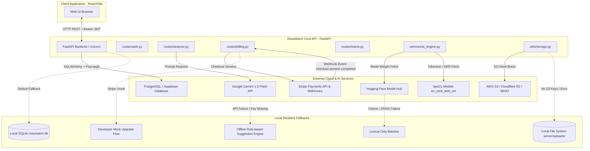
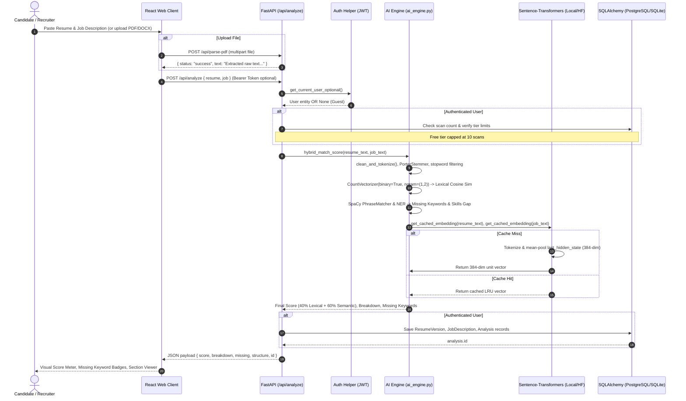
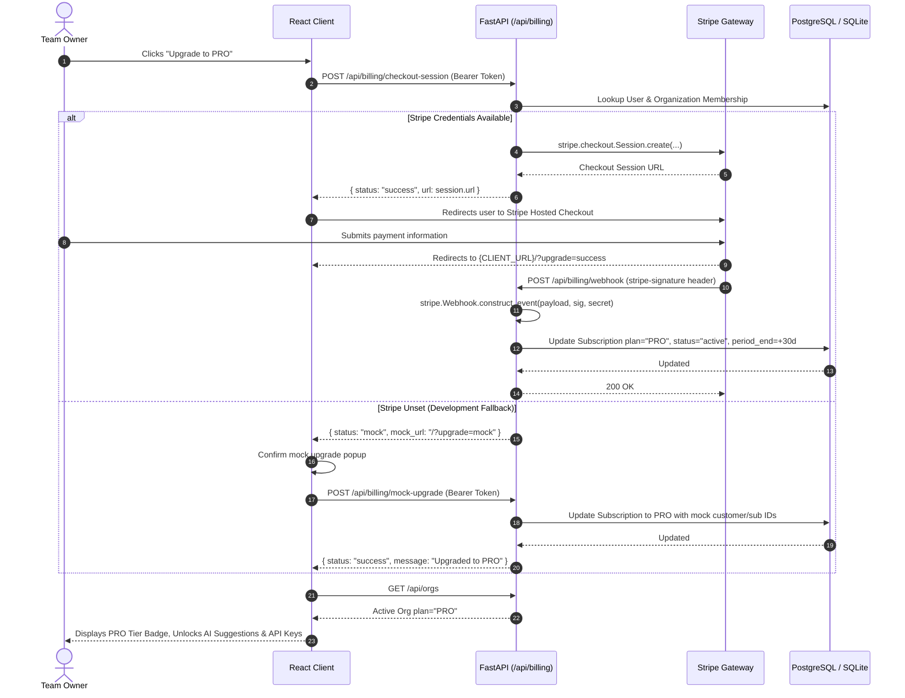
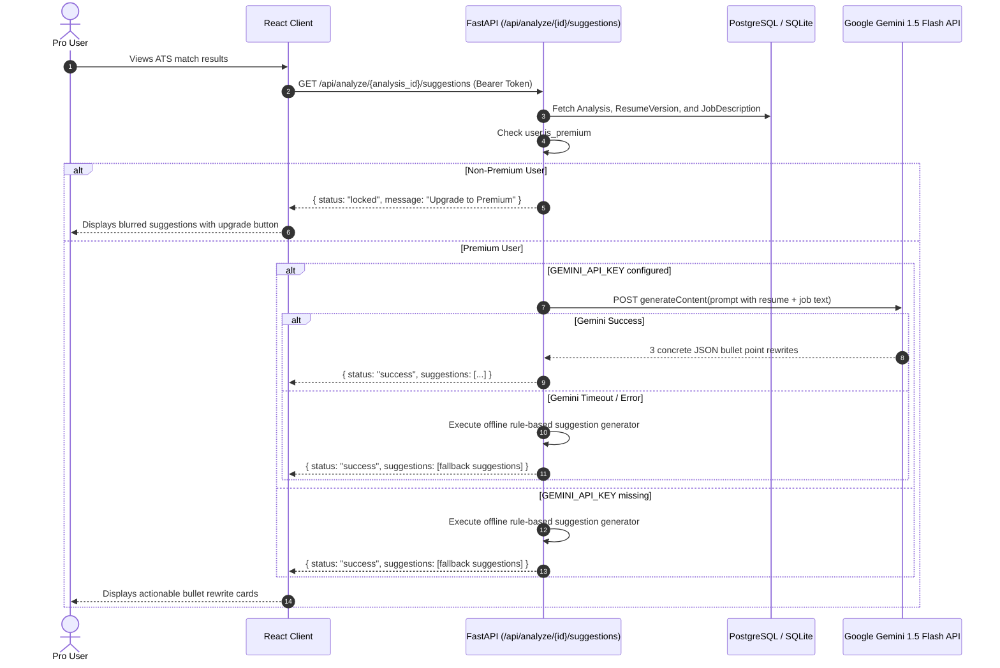

# ResuMatch AI — External Integrations & Data Flows

This document details all external services, third-party APIs, webhooks, cloud storage providers, machine learning hubs, authentication protocols, and offline fallback mechanisms implemented in **ResuMatch AI**.

---

## 1. External Services Architecture Map



---

## 2. External Services & APIs

### 2.1 Google Gemini API (Generative Resume Optimization)

- **Target Model**: `gemini-1.5-flash`
- **Endpoint**:
  ```http
  POST https://generativelanguage.googleapis.com/v1beta/models/gemini-1.5-flash:generateContent?key={GEMINI_API_KEY}
  ```
- **Invoked In**: `server/routes/analyze.py` (`get_bullet_suggestions`)
- **Access Tier**: Restricted to **PRO** and **TEAM** workspace users (`if not user.is_premium: return {"status": "locked"}`).
- **Purpose**: Generates 3 impactful, tailored resume bullet rewrites that incorporate identified missing keywords and skills against the job description.
- **Payload Schema**:
  ```json
  {
    "contents": [
      {
        "parts": [
          {
            "text": "You are an expert resume writer and recruiter... Resume Text: ... Job Description: ... Respond with ONLY the JSON array."
          }
        ]
      }
    ]
  }
  ```
- **Data Truncation**: Resume and job description texts are truncated to the first 4,000 characters each to avoid token limit overflow and minimize latency.
- **Response Parsing**: Cleans optional markdown code fence wrappers (` ```json ... ``` `) and parses the response string into a native JSON array of strings.
- **Offline / Failure Fallback**:
  - If `GEMINI_API_KEY` is not defined in the environment, or if the HTTP call raises a timeout or error:
  - An offline, rule-based recommendation generator executes automatically.
  - Generates advice emphasizing quantifiable metrics, action verbs, and explicitly injects the top 3 missing keywords identified during lexical analysis.
  - The client always receives a valid list of actionable suggestions.

---

### 2.2 Stripe (Payments & Subscription Management)

- **SDK**: `stripe==7.11.0`
- **Invoked In**: `server/routes/billing.py`
- **Environment Variables**:
  - `STRIPE_SECRET_KEY`: Private API key (`sk_live_...` or `sk_test_...`)
  - `STRIPE_PRICE_ID`: Recurring price ID (`price_...`) configured in Stripe Dashboard
  - `STRIPE_WEBHOOK_SECRET`: Secret used to verify webhook signatures (`whsec_...`)
  - `CLIENT_URL`: Base domain for redirection URLs (defaults to `http://localhost:5173`)

#### Stripe Workflows:

#### A. Checkout Session Creation (`POST /api/billing/checkout-session`)
- Requires authenticated user.
- Resolves the user's active `Organization` through their `Membership`.
- Calls `stripe.checkout.Session.create`:
  ```python
  session = stripe.checkout.Session.create(
      payment_method_types=['card'],
      line_items=[{'price': price_id, 'quantity': 1}],
      mode='subscription',
      success_url=f"{domain_url}/?upgrade=success",
      cancel_url=f"{domain_url}/?upgrade=cancel",
      client_reference_id=str(user.id),
      customer_email=user.email,
      metadata={"organization_id": membership.organization_id}
  )
  ```
- Returns `{ "status": "success", "url": session.url }` for client redirect.

#### B. Webhook Processing (`POST /api/billing/webhook`)
- Receives raw byte payload from Stripe.
- Validates cryptographic signature via `stripe.Webhook.construct_event(payload, sig_header, webhook_secret)`.
- Listens for `checkout.session.completed` event:
  - Extracts `organization_id` from `session.metadata`.
  - Extracts `customer` (Stripe Customer ID) and `subscription` (Stripe Subscription ID).
  - Queries `Subscription` table by `organization_id`.
  - Promotes the organization's plan to `PRO`, sets status to `active`, and sets `current_period_end` to 30 days ahead.
  - Commits transaction to database.

#### C. Fallback & Mock Billing Mode:
- If `STRIPE_SECRET_KEY` or `STRIPE_PRICE_ID` is missing:
  - `POST /api/billing/checkout-session` returns:
    ```json
    {
      "status": "mock",
      "message": "Stripe credentials not configured. Please use mock upgrade.",
      "mock_url": "http://localhost:5173/?upgrade=mock"
    }
    ```
  - The client detects `status: "mock"`, displays a confirmation prompt to the user, and calls `POST /api/billing/mock-upgrade`.
  - `mock-upgrade` updates the organization's `Subscription` row to `plan="PRO"`, assigning mock IDs (`cus_mock_...`, `sub_mock_...`).
  - This allows 100% of the SaaS features (unlimited scans, AI bullet rewrites, developer API keys) to be tested without active Stripe keys.

---

### 2.3 Hugging Face Hub (Semantic Model Downloads)

- **Target Model**: `sentence-transformers/all-MiniLM-L6-v2` (384-dimensional dense sentence embeddings).
- **Secondary Model**: `optimum/all-MiniLM-L6-v2` (ONNX optimized).
- **Data Flow**:
  - On startup or first execution of `server/services/ai_engine.py`, the system attempts to load tokenizer and model weights from the local cache.
  - If not cached locally, weights are automatically retrieved via HTTPS from `https://huggingface.co/sentence-transformers/all-MiniLM-L6-v2`.
  - Cached under user profile: `~/.cache/huggingface/hub/`.
- **Loading & Fallback Hierarchy**:
  1. **Primary**: PyTorch CPU via `transformers.AutoTokenizer` and `transformers.AutoModel`.
  2. **Secondary Fallback**: ONNX Runtime via `optimum.onnxruntime.ORTModelForFeatureExtraction`.
  3. **Tertiary Fallback**: If both loaders fail (e.g., in air-gapped environments or low-memory architectures), `model` is set to `None`. The system logs a warning, sets semantic similarity to `0.0`, and falls back to **lexical-only scoring** without crashing the API.
- **In-Memory Caching**:
  - `BoundedEmbeddingCache` maintains up to 128 document embeddings in an LRU `OrderedDict` guarded by a `threading.Lock()`.
  - Cache key is the 64-bit integer hash of the input text (`hash(text)`).

---

### 2.4 SpaCy Linguistic Hub

- **Model**: `en_core_web_sm`
- **Invoked In**: `server/services/ai_engine.py` (`_init_spacy`, `extract_skills_and_entities`)
- **Download Automation**:
  - Guarded by thread-safe double-checked locking (`_spacy_lock`).
  - Tries `spacy.load("en_core_web_sm")`. If not installed, invokes `spacy.cli.download("en_core_web_sm")` dynamically and reloads.
- **Responsibilities**:
  - **Named Entity Recognition (NER)**: Flags `ORG` (companies, organizations) and `PRODUCT` entities to compare against resume tokens.
  - **Skill Matcher**: Compiles 100+ common tech keywords (`COMMON_SKILLS`) into SpaCy `PhraseMatcher` patterns with `LOWER` attribute matching.
- **Offline Fallback**:
  - If download or initialization encounters an exception, it falls back to a regex word-boundary set comparison against `COMMON_SKILLS`.

---

### 2.5 NLTK Resource Repositories

- **Resources**: `punkt`, `stopwords`, `punkt_tab`
- **Invoked In**: `server/services/ai_engine.py` (`download_nltk_resources`)
- **Behavior**:
  - Checks presence via `nltk.data.find()`.
  - Downloads quietly on boot if absent (`nltk.download(res, quiet=True)`).
  - Stored in standard `nltk_data` directories.

---

### 2.6 Cloud Storage (AWS S3 / Cloudflare R2 / MinIO)

- **Module**: `server/utils/storage.py`
- **SDK**: `boto3` Session & Client
- **Configuration**:
  - `AWS_ACCESS_KEY_ID`: Cloud access key
  - `AWS_SECRET_ACCESS_KEY`: Cloud secret key
  - `AWS_DEFAULT_REGION`: Storage region (default: `us-east-1`)
  - `S3_ENDPOINT_URL`: Custom S3 endpoint (enables Cloudflare R2 or local MinIO)
  - `S3_BUCKET_NAME`: Target S3 bucket name
- **Storage Workflow**:
  ```python
  s3_client.put_object(
      Bucket=bucket_name,
      Key=unique_filename,
      Body=file_bytes,
      ContentType=content_type
  )
  ```
- **URL Resolution**:
  - Cloudflare R2 / Custom Endpoint: `{S3_ENDPOINT_URL}/{bucket_name}/{unique_filename}`
  - Standard AWS S3: `https://{bucket_name}.s3.{region}.amazonaws.com/{unique_filename}`
- **Local Fallback**:
  - If `AWS_ACCESS_KEY_ID` or `AWS_SECRET_ACCESS_KEY` is not provided, or if the S3 client raises a `ClientError`:
  - Automatically creates and writes to `server/uploads/` on the local disk.
  - Assigns a UUID filename (`f"{uuid.uuid4()}{ext}"`).
  - Returns local API path: `/api/uploads/{unique_filename}`.

---

### 2.7 Database Providers (PostgreSQL / Supabase / Neon)

- **Module**: `server/utils/db.py`
- **Driver**: `psycopg2-binary` for PostgreSQL; native SQLite driver for SQLite.
- **Connection Configuration**:
  - Reads `DATABASE_URL` from environment.
  - If `DATABASE_URL` starts with `sqlite`, adds `connect_args={"check_same_thread": False}`.
  - Sets `pool_pre_ping=True` to automatically recycle dropped or stale pooled connections (critical for Supabase / Neon connection poolers).
- **Supported Providers**:
  - Supabase (PostgreSQL with transaction pooling on port 6543 or session on 5432)
  - Neon Serverless PostgreSQL
  - AWS RDS PostgreSQL
  - Local Docker PostgreSQL
  - Local embedded SQLite (`resumatch.db`)

---

### 2.8 CI/CD Automated Code Review (OpenRouter + Qwen)

- **Workflow**: `.github/workflows/aion-review.yml`
- **Runner**: GitHub Actions (`ubuntu-latest`)
- **Triggers**:
  - Pull requests (`opened`, `synchronize`, `reopened`)
  - PR comments beginning with `/review`
- **Action**: `Wall-E-30/code-reviewer@main`
- **Provider**: `openrouter`
- **Model**: `qwen/qwen-2.5-coder-32b-instruct`
- **Secrets Required**: `OPENROUTER_API_KEY`, `GITHUB_TOKEN`
- **Mode**: Visible PR comments, fails check on critical security/syntax findings (`fail-on-findings: 'true'`).

---

## 3. Detailed Data Flow Diagrams

### 3.1 Resume Analysis & Hybrid Scoring Flow



---

### 3.2 Subscription Upgrade & Stripe Webhook Flow



---

### 3.3 AI Bullet Point Rewrite Flow



---

## 4. Authentication & Credentials Matrix

| Integration | Auth Mechanism | Secret / Credential | Scope / Permissions | Rotation Method |
| :--- | :--- | :--- | :--- | :--- |
| **API Client Auth** | Bearer JWT (`HS256`) | `SECRET_KEY` | User identification (`sub`), 7-day lifespan | Update env var; invalidates active sessions |
| **Developer API** | Custom Bearer Header | `rm_<token_urlsafe(32)>` | Scopes: `read`, `write`. SHA-256 hashed in DB | Revoke via UI (`DELETE /api/apikeys/{id}`) |
| **Google Gemini** | Query Parameter | `GEMINI_API_KEY` | `gemini-1.5-flash:generateContent` | Rotate in Google Cloud / AI Studio |
| **Stripe API** | Bearer Secret Key | `STRIPE_SECRET_KEY` | Subscription session creation | Rotate in Stripe Dashboard |
| **Stripe Webhook** | HMAC-SHA256 Header | `STRIPE_WEBHOOK_SECRET` | Webhook event verification (`stripe-signature`) | Roll secret in Stripe Webhook Settings |
| **Cloud Storage** | AWS Signature v4 | `AWS_ACCESS_KEY_ID`, `AWS_SECRET_ACCESS_KEY` | `s3:PutObject`, `s3:GetObject` on bucket | Rotate via AWS IAM / Cloudflare API Tokens |
| **PostgreSQL** | Database Connection URI | `DATABASE_URL` | DDL & DML permissions on public schema | Update connection string |
| **OpenRouter CI** | Bearer Header | `OPENROUTER_API_KEY` | Qwen 2.5 Coder 32B inference | Rotate in GitHub Repository Secrets |

---

## 5. Webhook Endpoints & Event Handlers

### 5.1 Inbound Webhooks

#### `POST /api/billing/webhook`
- **Provider**: Stripe
- **Signature Header**: `stripe-signature`
- **Supported Events**:
  - `checkout.session.completed`:
    - Reads `client_reference_id` (User ID) and `metadata.organization_id`.
    - Updates or creates `Subscription` model record.
    - Sets `plan = "PRO"`, `status = "active"`, `current_period_end = now + 30 days`.
- **Response Codes**:
  - `200 OK`: Event processed or ignored safely.
  - `400 Bad Request`: Invalid signature or missing `STRIPE_WEBHOOK_SECRET`.

---

## 6. Resilience & Offline Fallback Strategy Summary

ResuMatch AI is engineered to run seamlessly across three distinct deployment tiers without catastrophic failure:

| System Layer | Production (Full Cloud) | Development / Local | Air-Gapped / Offline |
| :--- | :--- | :--- | :--- |
| **Relational Database** | Managed PostgreSQL (Supabase / RDS) | SQLite (`resumatch.db`) | SQLite (`resumatch.db`) |
| **Billing / Upgrades** | Stripe Checkout + Webhook | Mock Upgrade Endpoint (`/mock-upgrade`) | Mock Upgrade Endpoint (`/mock-upgrade`) |
| **AI Rewrites** | Google Gemini 1.5 Flash | Google Gemini 1.5 Flash | Rule-based missing skill recommender |
| **Semantic Matching** | PyTorch CPU `all-MiniLM-L6-v2` | ONNX Runtime `all-MiniLM-L6-v2` | Zero-vector fallback (100% Lexical score) |
| **Skill Extraction** | SpaCy `en_core_web_sm` + PhraseMatcher | SpaCy `en_core_web_sm` | Regex token match on `COMMON_SKILLS` |
| **Resume File Storage** | Cloudflare R2 / AWS S3 | Local disk (`server/uploads/`) | Local disk (`server/uploads/`) |
| **Report Export** | On-the-fly streaming PDF (ReportLab) | On-the-fly streaming PDF (ReportLab) | On-the-fly streaming PDF (ReportLab) |
