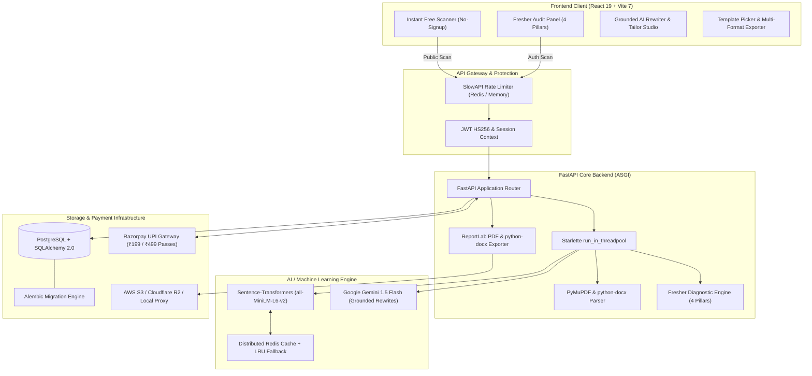

<div align="center">

# 🎓 ResuMatch AI

### *The AI Resume Copilot Built for Freshers & Students*
#### *Optimized for 2024–2026 Campus Placement Drives & First Tech Jobs in India*

[](https://github.com/sharancreates/resumatch/actions/workflows/ci.yml)
[](https://fastapi.tiangolo.com)
[](https://www.python.org/)
[](https://react.dev/)
[](https://vitejs.dev/)
[](https://tailwindcss.com/)
[](https://www.postgresql.org/)
[](https://redis.io/)
[](LICENSE)

<p align="center">
  <b>ResuMatch AI</b> is built specifically for college students and fresh graduates (0–2 years experience) navigating campus recruitment and off-campus tech drives. It pairs a high-precision <b>Dual Hybrid Engine (40% Lexical + 60% Semantic)</b> with a <b>4-Pillar Fresher Diagnostic Suite</b>, <b>grounded anti-hallucination AI bullet rewrites</b>, <b>strict single-page ATS templates (PDF & DOCX)</b>, and <b>student micro-pricing (₹199 Sprint Pass via UPI)</b>.
</p>

[⚡ Try Instant Free Scan](#-instant-no-signup-free-scanner) •
[🧠 Hybrid Engine](#-the-hybrid-ats-matching-engine) •
[🛠 Fresher Diagnostics](#-4-pillar-fresher-diagnostics) •
[🏛 Architecture](#-system-architecture) •
[🚀 Quickstart](#-quickstart-guide) •
[📡 API Reference](#-rest-api-reference)

---

</div>

## 📑 Table of Contents

- [The Fresher Placement Challenge](#-the-fresher-placement-challenge)
- [The Hybrid ATS Matching Engine](#-the-hybrid-ats-matching-engine)
- [✨ Key Features](#-key-features)
  - [1. Instant No-Signup Free Scanner](#1-instant-no-signup-free-scanner)
  - [2. 4-Pillar Fresher Diagnostic Suite](#2-4-pillar-fresher-diagnostic-suite)
  - [3. Grounded AI Bullet Rewriter & Tailoring Studio](#3-grounded-ai-bullet-rewriter--tailoring-studio)
  - [4. Fresher ATS Templates & Dual-Format Export](#4-fresher-ats-templates--dual-format-export)
  - [5. Student Micro-Pricing & Viral Referral Engine](#5-student-micro-pricing--viral-referral-engine)
  - [6. High-Throughput Performance & Concurrency](#6-high-throughput-performance--concurrency)
- [🏛 System Architecture](#-system-architecture)
- [🛠 Tech Stack](#-tech-stack)
- [🚀 Quickstart Guide](#-quickstart-guide)
  - [Prerequisites](#prerequisites)
  - [1. Backend Setup](#1-backend-setup)
  - [2. Frontend Setup](#2-frontend-setup)
  - [3. Database Migrations](#3-database-migrations)
- [📡 REST API Reference](#-rest-api-reference)
- [⚙️ Environment Variables](#-environment-variables)
- [🧪 Testing & Quality Assurance](#-testing--quality-assurance)
- [📄 License](#-license)

---

## 🎯 The Fresher Placement Challenge

Most commercial resume tools are built for US executives with 10+ years of corporate experience. When applied to freshers in India, they fail:
- **No Corporate History**: Students have academic projects, hackathons, open-source work, and coursework—not corporate employment titles.
- **Identical College Templates**: Resumes look identical across thousands of campus peers, causing placement bots to discard them at scale.
- **Table & Column Traps**: Indian college placement cell formats often use multi-column tables, photos, or non-standard headers that crash automated ATS parsers.
- **Unreasonable Subscriptions**: US-based SaaS products charge ₹1,500–₹3,000/month recurring fees that students simply cannot afford.

**ResuMatch AI acts as a smart, knowledgeable senior:** giving honest, actionable diagnostics on your projects, replacing weak verbs, grounding AI improvements in truth, and making professional ATS compliance accessible for the price of a campus canteen meal.

---

## 🧠 The Hybrid ATS Matching Engine

Applicant Tracking Systems in campus drives use two layers: exact keyword filters (to screen out candidates lacking core skills) and semantic similarity models (to evaluate contextual alignment).

ResuMatch AI mirrors this dual-layer pipeline:

```
                  ┌────────────────────────────────────────────────────────┐
                  │                 Target Job Description                 │
                  └───────────────────────────┬────────────────────────────┘
                                              │
                      ┌───────────────────────┴───────────────────────┐
                      ▼                                               ▼
         ┌─────────────────────────┐                     ┌─────────────────────────┐
         │   Lexical Match (40%)   │                     │  Semantic Vector (60%)  │
         │ Exact Keywords & Stems  │                     │ Dense Vector Embedding  │
         │ CountVectorizer + NLTK  │                     │ all-MiniLM-L6-v2 (ONNX) │
         └────────────┬────────────┘                     └────────────┬────────────┘
                      │                                               │
                      └───────────────────────┬───────────────────────┘
                                              ▼
                                ┌─────────────────────────────┐
                                │  Composite ATS Match Score  │
                                │   (40% Lex + 60% Semantic)  │
                                └─────────────────────────────┘
```

1. **40% Exact Lexical Match (`Scikit-Learn` + NLTK Stemming)**:
   Extracts token n-grams and computes cosine overlap against normalized skill dictionaries, verifying essential technologies (e.g., `React`, `FastAPI`, `Docker`, `PostgreSQL`).
2. **60% Dense Semantic Vector Similarity (`all-MiniLM-L6-v2`)**:
   Encodes resume bullets and job requirements into 384-dimensional dense vectors. Recognizes that *"Engineered high-throughput task queue in Redis"* strongly aligns with *"Backend distributed systems development"*.
3. **Immediate Gap Analysis**:
   Pinpoints exact missing technical skills, flags redundant filler words, and delivers prioritized recommendations to maximize shortlisting rates.

---

## ✨ Key Features

### 1. Instant No-Signup Free Scanner
- **Zero Friction**: Paste resume text or drop a PDF/DOCX file and a target job description directly on the landing page—no sign-up or credit card required.
- **3 Free Scans**: Tracked seamlessly via guest client IDs in `localStorage` and enforced by server-side rate limiters.
- **Shareable WhatsApp / LinkedIn Scorecard**: Instant visual scorecard dialog displaying match score, keyword overlap, and top missing skills for peer sharing.
- **DPDP Act 2023 Compliant**: 100% student data privacy guarantee—resumes are never used to train external AI models and are purged on demand.

### 2. 4-Pillar Fresher Diagnostic Suite
Custom heuristics specifically tailored for campus applicants and entry-level software roles:
- **🛠️ Project Quality Checker**: Audits academic and personal projects for explicit tech stacks, candidate ownership, and quantifiable impact metrics (e.g., *"reduced latency by 35%"*, *"served 1,200 users"*).
- **⚡ Weak Verb Detector**: Scans bullet points for passive phrases (*"worked on"*, *"assisted with"*, *"handled"*) and provides 1-click replacement buttons with assertive action verbs (*"architected"*, *"engineered"*, *"implemented"*).
- **🔗 Links & Proof Audit**: Validates critical online evidence including active GitHub profile, LinkedIn URL, portfolio links, categorized technical skill groupings, and core CS coursework (DBMS, OS, Networks).
- **📄 1-Page ATS Safe Layout**: Checks total word count against single-page campus standards (350–550 words) and warns against parser-breaking formatting (tables, columns, photos).

### 3. Grounded AI Bullet Rewriter & Tailoring Studio
- **Anti-Hallucination Guardrails**: Powered by Google Gemini 1.5 Flash with strict grounding prompts. AI rewriters are forbidden from inventing technologies, metrics, or experiences not present in the original bullet.
- **Keyword Integration**: Select 1–3 missing skills (e.g., `Docker`, `PostgreSQL`) and watch the rewriter naturally integrate them around existing candidate accomplishments.
- **1-Click Job Tailoring (`POST /api/resume/tailor`)**: Rewrites entire resume sections to align with a specific job description while strictly retaining original factual truth.

### 4. Fresher ATS Templates & Dual-Format Export
- **4 Proven Fresher Templates**:
  1. *Classic Tech*: High-density layout prioritizing grouped skills and backend/full-stack project stacks.
  2. *Modern Minimal*: Clean sans-serif layout with subtle dividers for web and frontend roles.
  3. *Data & Analytics*: Highlights datasets, statistical models, SQL queries, and quantitative outcomes.
  4. *Campus Placement Standard*: University-compliant hierarchy with academic degrees, CGPA, and coursework featured prominently first.
- **Dual Format Support (`POST /api/resume/export`)**:
  - **ATS-Safe PDF**: Clean, single-page PDF generated dynamically using ReportLab.
  - **Editable Word (DOCX)**: Standard headings and bullets created with `python-docx` for college placement portals requiring `.docx` submissions.

### 5. Student Micro-Pricing & Viral Referral Engine
- **No Monthly Traps**: Replaced expensive recurring US SaaS subscriptions with student-friendly passes:
  - **Free Tier (₹0)**: 3 full scans, missing skills gap analysis, shareable scorecards.
  - **Sprint Pass (₹199 / 14 days)**: Unlimited scans, AI bullet rewriter, 1-click tailoring, 4 ATS templates, and instant UPI checkout.
  - **Placement Season Pass (₹499 / 90 days)**: Complete 3-month coverage for full college campus placement seasons.
- **One-Tap Razorpay UPI**: Seamless mobile payment with Google Pay, PhonePe, Paytm, and UPI QR codes.
- **Viral Peer Referral Engine ("Invite 3 Friends → Get 7 Days Free")**:
  - Every registered student receives a unique 7-character referral code (`?ref=CODE`).
  - Automatically awards 7 bonus days of Sprint Pass when 3 referred friends sign up.
  - 1-click WhatsApp and LinkedIn referral sharing.
- **College Placement Cell Bulk Licensing**: Campus-wide licensing available at `campus@resumatch.io`.

### 6. High-Throughput Performance & Concurrency
- **Threadpool ML Offloading**: Offloads heavy vector embeddings and PyTorch computations to background threads via `run_in_threadpool`, keeping FastAPI's ASGI event loop fully non-blocking.
- **Two-Tier Embedding Cache**: High-performance binary vector caching in Redis with automated fallback to an in-memory bounded LRU cache.
- **DDoS & Scraping Protection**: Intelligent rate limiting powered by `slowapi` throttling burst requests on public analysis endpoints.
- **Optimized Bundle Splitting**: Rollup chunk splitting (`vendor-react`, `vendor-network`) ensures sub-second page loads even on 3G campus Wi-Fi.

---

## 🏛 System Architecture



---

## 🛠 Tech Stack

| Layer | Technologies | Description |
| :--- | :--- | :--- |
| **Frontend Framework** | React 19, Vite 7 | Modern reactive single-page architecture |
| **Styling & UI** | Tailwind CSS 3.4, Lucide Icons | Responsive mobile-first campus styling |
| **Frontend Testing** | Vitest 3, React Testing Library, JSDOM | Fast unit and component test suite |
| **Backend Framework** | FastAPI 0.110+, Starlette, Uvicorn | High-throughput asynchronous ASGI backend |
| **AI / NLP Models** | `all-MiniLM-L6-v2`, Sentence-Transformers | 384-dimensional dense semantic embeddings |
| **Generative AI** | Google Gemini 1.5 Flash | Grounded bullet point rewriter & tailoring |
| **Document Processing** | PyMuPDF, `python-docx`, ReportLab | Universal parsing and multi-format ATS exports |
| **Database & ORM** | PostgreSQL (Prod) / SQLite (Dev), SQLAlchemy 2.0 | Async schema, relationship mapping, and indexing |
| **Migrations** | Alembic | Version-controlled declarative migration graph |
| **Cache & Throttling** | Redis 5+, `slowapi`, In-Memory LRU | Binary vector caching and burst rate limiting |
| **Payments** | Razorpay SDK | UPI one-tap orders, webhook signatures, micro-passes |
| **CI / CD Pipeline** | GitHub Actions | Automated Python 3.11 & Node 20 test pipelines |

---

## 🚀 Quickstart Guide

### Prerequisites
- **Python**: `3.11+`
- **Node.js**: `20.x+` (with `npm` or `pnpm`)
- **Database**: PostgreSQL (recommended) or SQLite
- **Redis** *(Optional)*: For distributed caching and rate limiting

---

### 1. Backend Setup

```bash
# 1. Navigate to the server directory
cd server

# 2. Create and activate a Python virtual environment
python -m venv venv
# On Windows (PowerShell):
.\venv\Scripts\Activate.ps1
# On Linux/macOS:
source venv/bin/activate

# 3. Install dependencies
pip install -r requirements.txt

# 4. Configure environment variables
cp .env.example .env

# 5. Apply Alembic database migrations
python -m alembic upgrade head

# 6. Start the FastAPI development server
python app.py
```
> The API server will be live at **`http://localhost:5001`** (Interactive Swagger docs at **`http://localhost:5001/docs`**).

---

### 2. Frontend Setup

```bash
# 1. Navigate to the client directory
cd client

# 2. Install dependencies
npm install

# 3. Launch the Vite development server
npm run dev
```
> The React SPA will open at **`http://localhost:5173`**.

---

### 3. Database Migrations

ResuMatch uses Alembic for database schema evolution:

```bash
cd server

# Check current revision head
python -m alembic heads

# Apply all forward migrations
python -m alembic upgrade head

# Rollback one migration revision
python -m alembic downgrade -1
```

---

## 📡 REST API Reference

### ⚡ Public & Authenticated ATS Analysis
| Method | Endpoint | Description | Auth |
| :--- | :--- | :--- | :---: |
| `POST` | `/api/analyze/public` | Free no-signup scan (3 scans/guest, match score & top gaps) | Public |
| `POST` | `/api/analyze` | Full hybrid ATS analysis + 4-pillar fresher diagnostic suite | Optional JWT |
| `POST` | `/api/parse-pdf` | Extract clean text from uploaded PDF or DOCX file | Public |
| `GET` | `/api/history` | Retrieve historical scan results and scorecards | Bearer Token |

### ✍️ Grounded AI Rewriter & Tailoring Studio
| Method | Endpoint | Description | Auth |
| :--- | :--- | :--- | :---: |
| `POST` | `/api/resume/rewrite-bullet` | Strengthen weak bullet with metrics & selected skills (Gemini) | Student Pass |
| `POST` | `/api/resume/tailor` | 1-click tailored resume generator matching target JD | Student Pass |

### 📄 Templates & Multi-Format Exporter
| Method | Endpoint | Description | Auth |
| :--- | :--- | :--- | :---: |
| `POST` | `/api/resume/export` | Generate single-page ATS-compliant PDF or DOCX resume | Public / Token |
| `POST` | `/api/reports/generate/{id}` | Generate branded ReportLab evaluation scorecard PDF | Bearer Token |
| `GET` | `/api/reports/{id}` | Download persistent PDF match report permalink | Public / Token |

### 💳 Student Micro-Pricing & Razorpay UPI
| Method | Endpoint | Description | Auth |
| :--- | :--- | :--- | :---: |
| `GET` | `/api/billing/plans` | Fetch active student plan catalog (Sprint Pass, Placement Season) | Public |
| `POST` | `/api/billing/order` | Create Razorpay order (₹199 / ₹499 in paise) | Bearer Token |
| `POST` | `/api/billing/verify` | Verify Razorpay HMAC SHA-256 signature and activate pass | Bearer Token |
| `POST` | `/api/billing/webhook` | Asynchronous webhook handler for payment capture | Razorpay Secret |
| `POST` | `/api/billing/mock-upgrade` | Development-only instant upgrade *(blocked in production)* | Bearer Token |

### 🎁 Viral Referrals & Account
| Method | Endpoint | Description | Auth |
| :--- | :--- | :--- | :---: |
| `POST` | `/api/auth/register` | Register student account with optional `referred_by_code` | Public |
| `POST` | `/api/auth/login` | Authenticate with email/password and obtain JWT | Public |
| `GET` | `/api/referrals/me` | Get personal referral code, share URL, and milestone progress | Bearer Token |

---

## ⚙️ Environment Variables

Create a `.env` file in the `server/` directory:

| Variable | Description | Default | Required in Production |
| :--- | :--- | :--- | :---: |
| `DATABASE_URL` | PostgreSQL connection URI | `sqlite:///./resumatch.db` | **Yes** |
| `SECRET_KEY` | JWT HS256 cryptographic signing key | `dev-secret-key-resumatch-9821` | **Yes** |
| `ENVIRONMENT` | Environment flag (`development` / `production`) | `development` | **Yes** |
| `ALLOWED_ORIGINS`| Permitted CORS frontend origins | `http://localhost:5173` | **Yes** |
| `GEMINI_API_KEY` | Google Gemini 1.5 Flash API Key for bullet rewrites | `None` (Mock fallback) | Recommended |
| `RAZORPAY_KEY_ID` | Razorpay live/test Key ID | `None` (Mock mode) | If billing enabled |
| `RAZORPAY_KEY_SECRET` | Razorpay live/test Secret Key | `None` (Mock mode) | If billing enabled |
| `RAZORPAY_WEBHOOK_SECRET` | Razorpay Webhook signature verification secret | `None` | If webhooks enabled |
| `REDIS_URL` | Redis URI for vector caching & rate limiting | `memory://` fallback | Recommended |
| `S3_BUCKET_NAME` | AWS S3 or Cloudflare R2 bucket for file storage | Local disk proxy fallback | Optional |
| `AWS_ACCESS_KEY_ID` | Cloud storage access credentials | `None` | If S3 enabled |
| `AWS_SECRET_ACCESS_KEY` | Cloud storage secret credentials | `None` | If S3 enabled |

---

## 🧪 Testing & Quality Assurance

ResuMatch maintains automated testing across both backend and frontend layers:

```bash
# --- Backend Pytest Suite ---
cd server
PYTHONPATH=. python -m pytest tests/ -v
```

```bash
# --- Frontend Vitest Suite ---
cd client

# Run ESLint (0 errors, 0 warnings)
npm run lint

# Run Vitest component & unit tests (28 tests across 6 suites)
npm run test:run

# Verify production Vite build
npm run build
```

### GitHub Actions CI
All commits and pull requests trigger automated verification via `.github/workflows/ci.yml`:
- **Python 3.11**: Compilation check, Alembic migration verification, and backend pytest suite.
- **Node 20**: ESLint check, Vitest run, and clean Vite production build.

---

## 📄 License

This project is licensed under the **MIT License** — see the [LICENSE](LICENSE) file for details.

<div align="center">
  <sub>Built for students and freshers navigating campus recruitment. Engineered with FastAPI, PyTorch, React, and Razorpay.</sub>
</div>
