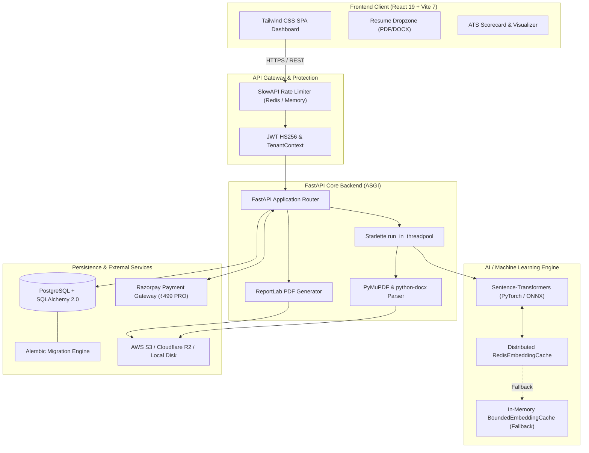

<div align="center">

# 🚀 ResuMatch AI

### *Next-Generation Hybrid ATS Resume Optimizer & Recruitment Intelligence Platform*

[](https://github.com/sharancreates/resumatch/actions/workflows/ci.yml)
[](https://fastapi.tiangolo.com)
[](https://www.python.org/)
[](https://react.dev/)
[](https://vitejs.dev/)
[](https://tailwindcss.com/)
[](https://www.postgresql.org/)
[](https://redis.io/)
[](LICENSE)

<p align="center">
  <b>ResuMatch AI</b> evaluates and optimizes resumes against target job descriptions using a patent-grade hybrid scoring algorithm that combines <b>40% Exact Lexical Match</b> with <b>60% Deep Semantic Vector Similarity</b>. Built with multi-tenant workspaces, cloud document persistence, ReportLab ATS exports, Razorpay billing automation, and non-blocking asynchronous ML concurrency.
</p>

[Explore Features](#-key-features) •
[System Architecture](#-system-architecture) •
[Quickstart](#-quickstart-guide) •
[API Reference](#-rest-api-reference) •
[Configuration](#-environment-variables)

---

</div>

## 📑 Table of Contents

- [The Core Problem & Hybrid Solution](#-the-core-problem--the-hybrid-engine)
- [System Architecture](#-system-architecture)
- [Key Features](#-key-features)
- [Tech Stack](#-tech-stack)
- [Quickstart Guide](#-quickstart-guide)
  - [Prerequisites](#prerequisites)
  - [1. Backend Setup](#1-backend-setup)
  - [2. Frontend Setup](#2-frontend-setup)
  - [3. Database Migrations](#3-database-migrations)
- [REST API Reference](#-rest-api-reference)
- [Environment Variables](#-environment-variables)
- [Testing & Quality Assurance](#-testing--quality-assurance)
- [License](#-license)

---

## 🧠 The Core Problem & The Hybrid Engine

Traditional Applicant Tracking Systems (ATS) rely on rigid keyword matchers that reject qualified applicants because of minor phrasing variations. Conversely, pure semantic search systems often miss essential hard requirements, credentials, and industry abbreviations.

**ResuMatch AI solves this with a balanced, dual-engine evaluation model:**

```
                  ┌────────────────────────────────────────────────────────┐
                  │                 Target Job Description                 │
                  └───────────────────────────┬────────────────────────────┘
                                              │
                      ┌───────────────────────┴───────────────────────┐
                      ▼                                               ▼
         ┌─────────────────────────┐                     ┌─────────────────────────┐
         │   Lexical Match (40%)   │                     │  Semantic Vector (60%)  │
         │ Exact Keywords & Stems  │                     │ Dense Vector Embedding  │
         │ CountVectorizer + NLTK  │                     │ all-MiniLM-L6-v2 (ONNX) │
         └────────────┬────────────┘                     └────────────┬────────────┘
                      │                                               │
                      └───────────────────────┬───────────────────────┘
                                              ▼
                               ┌─────────────────────────────┐
                               │  Composite ATS Match Score  │
                               │   (40% Lex + 60% Semantic)  │
                               └─────────────────────────────┘
```

1. **40% Lexical Matching (`Scikit-Learn` + NLTK)**:
   Extracts token n-grams and computes cosine overlap across normalized keyword dictionaries, ensuring critical certifications and technical keywords are present.
2. **60% Semantic Similarity (`all-MiniLM-L6-v2`)**:
   Translates candidate experience paragraphs into 384-dimensional dense vector embeddings. Recognizes that *"Orchestrated high-throughput microservices in Kubernetes"* matches *"Container platform leadership"*.
3. **Skills Gap & Recommendation Extraction**:
   Identifies omitted industry keywords, tags missing competencies, and produces contextual suggestions to maximize interview conversion rates.

---

## 🏛 System Architecture



---

## ✨ Key Features

### 🎯 Intelligent Resume Scoring & Parsing
- **Universal Document Ingestion**: Securely extracts text, layout, and metadata from PDF (`PyMuPDF`) and Word (`python-docx`) files with magic-byte validation (`%PDF-`, `PK\x03\x04`).
- **AST Section Segmenter**: Parses experience, skills, education, and contact details into structured JSON schemas.
- **Actionable Gap Analysis**: Delivers immediate feedback on missing hard skills, redundant keywords, and formatting recommendations.

### 🏢 Multi-Tenant Workspaces & RBAC
- **Organization Hierarchy**: Isolated tenant workspaces where team members collaborate under defined roles (`OWNER`, `ADMIN`, `MEMBER`, `VIEWER`).
- **Audit Logging**: Immutable audit ledger (`audit_logs`) tracking administrative events, membership changes, and billing actions.
- **Hashed API Keys**: High-throughput REST API key management with SHA-256 key hashing and customizable rate limits.

### ☁️ Cloud Storage & Branded Report Lab Exports
- **Multi-Cloud File Persistence**: Pluggable storage engine supporting AWS S3, Cloudflare R2, MinIO, or local disk storage with authenticated presigned download URLs.
- **Publication-Ready ATS Reports**: Generates professional PDF evaluations using ReportLab with score breakdowns, skill tables, and shareable permalinks (`/api/reports/{id}`).

### 💳 Razorpay Billing Lifecycle & Guardrails
- **Native Razorpay Integration**: Order creation (`POST /api/billing/order`) with ₹499 PRO monthly subscription tier.
- **Cryptographic Signature Verification**: Validates HMAC SHA-256 signatures (`order_id|payment_id`) against `RAZORPAY_KEY_SECRET`.
- **Asynchronous Webhook Automation**: Handles `order.paid`, `payment.captured`, and cancellations with idempotent transaction records.
- **Production Guardrails**: Mock upgrades and default developer secrets are strictly blocked in production mode.

### ⚡ Concurrency & Production Hardening
- **Threadpool ML Offloading**: Offloads heavy matrix calculations to worker threads via `run_in_threadpool`, keeping the ASGI event loop responsive.
- **Two-Tier Embedding Cache**: High-performance binary vector serialization in Redis with automatic fallback to bounded LRU memory.
- **DDoS Rate Limiting**: Distributed rate limiting powered by `slowapi` throttling sensitive endpoints (e.g. `/api/analyze`, `/api/auth/*`).
- **Optimized Bundle Splitting**: Rollup chunk splitting (`vendor-react`, `vendor-network`) with Vitest unit tests and GitHub Actions CI.

---

## 🛠 Tech Stack

| Layer | Technologies |
| :--- | :--- |
| **Frontend** | React 19, Vite 7, Tailwind CSS, Axios, Lucide Icons |
| **Frontend Testing** | Vitest, React Testing Library, JSDOM |
| **Backend Framework** | FastAPI (ASGI), Starlette, Uvicorn |
| **AI / NLP Engine** | Sentence-Transformers (`all-MiniLM-L6-v2`), PyTorch, ONNX Runtime, Scikit-Learn, NLTK, SpaCy |
| **Database & ORM** | PostgreSQL (Production) / SQLite (Dev), SQLAlchemy 2.0, Alembic |
| **Caching & Limiting** | Redis 5+, `slowapi`, Bounded Memory LRU |
| **Document Processing** | PyMuPDF (MuPDF), `python-docx`, ReportLab |
| **Object Storage** | AWS S3, Cloudflare R2, MinIO, Local Disk Proxy |
| **Payment Gateway** | Razorpay (Orders, Webhooks, HMAC Verification) |
| **CI / CD** | GitHub Actions (Python 3.11 + Node 20) |

---

## 🚀 Quickstart Guide

### Prerequisites
- **Python**: `3.11+`
- **Node.js**: `20.x+` (with `npm` or `pnpm`)
- **Database**: PostgreSQL (recommended) or local SQLite
- **Redis** *(Optional)*: For distributed caching and rate limiting

---

### 1. Backend Setup

```bash
# 1. Navigate to the server directory
cd server

# 2. Create and activate a Python virtual environment
python -m venv venv
# On Windows:
.\venv\Scripts\activate
# On Linux/macOS:
source venv/bin/activate

# 3. Install dependencies
pip install -r requirements.txt

# 4. Configure environment variables
cp .env.example .env

# 5. Run Alembic migrations
python -m alembic upgrade head

# 6. Start the API server
python app.py
```
> The FastAPI backend will be available at **`http://localhost:5001`** (API docs at **`http://localhost:5001/docs`**).

---

### 2. Frontend Setup

```bash
# 1. Navigate to the client directory
cd client

# 2. Install dependencies
npm install

# 3. Run the development server
npm run dev
```
> The React SPA will open at **`http://localhost:5173`**.

---

### 3. Database Migrations

ResuMatch uses Alembic for declarative schema migrations:

```bash
cd server

# Inspect migration head
python -m alembic heads

# Apply all forward migrations
python -m alembic upgrade head

# Rollback one revision
python -m alembic downgrade -1
```

---

## 📡 REST API Reference

### 🔐 Authentication & Organizations
| Method | Endpoint | Description | Auth |
| :--- | :--- | :--- | :---: |
| `POST` | `/api/auth/register` | Register a new user and generate default workspace | Public |
| `POST` | `/api/auth/login` | Authenticate with email/password and obtain JWT | Public |
| `GET` | `/api/teams/orgs` | List organizations accessible to current user | Bearer Token |
| `POST` | `/api/teams/orgs` | Create a new organization workspace | Bearer Token |
| `POST` | `/api/teams/members` | Invite a team member to active workspace | OWNER / ADMIN |

### ⚡ Resume Parsing & ATS Analysis
| Method | Endpoint | Description | Auth |
| :--- | :--- | :--- | :---: |
| `POST` | `/api/parse-pdf` | Parse raw PDF/DOCX file and persist to storage | Public |
| `POST` | `/api/analyze` | Execute hybrid 40/60 ATS evaluation between resume and job | Optional Token |
| `POST` | `/api/resumes/upload` | Upload resume and associate version with workspace | Bearer Token |
| `GET` | `/api/history` | Retrieve historical scan results scoped to organization | Bearer Token |
| `GET` | `/api/resumes/{id}/versions/{vid}/download` | Generate presigned download URL for stored resume | Tenant Member |

### 📊 Reports & Evaluations
| Method | Endpoint | Description | Auth |
| :--- | :--- | :--- | :---: |
| `POST` | `/api/reports/generate/{analysis_id}` | Build and store ReportLab PDF evaluation report | Bearer Token |
| `GET` | `/api/reports/{report_id}` | Fetch persistent report details and PDF URL | Public / Token |
| `GET` | `/api/orgs/{org_id}/reports` | List all generated ATS reports for workspace | Tenant Member |

### 💳 Razorpay Billing
| Method | Endpoint | Description | Auth |
| :--- | :--- | :--- | :---: |
| `POST` | `/api/billing/order` | Create a Razorpay order for ₹499 PRO upgrade | OWNER / ADMIN |
| `POST` | `/api/billing/verify` | Verify HMAC SHA-256 payment signature & activate PRO | OWNER / ADMIN |
| `POST` | `/api/billing/webhook` | Process asynchronous payment and subscription events | Webhook HMAC |
| `POST` | `/api/billing/mock-upgrade` | Development mock upgrade *(disabled in production)* | Bearer Token |

---

## ⚙️ Environment Variables

Create a `.env` file in the `server/` directory:

| Variable | Description | Default | Required in Production |
| :--- | :--- | :--- | :---: |
| `DATABASE_URL` | PostgreSQL connection string | `sqlite:///./resumatch.db` | **Yes** |
| `SECRET_KEY` | JWT HS256 secret key | `dev-secret-key-resumatch-9821` | **Yes** |
| `ENVIRONMENT` | Environment flag (`development`, `production`) | `development` | **Yes** |
| `ALLOWED_ORIGINS`| Comma-separated CORS origins | `http://localhost:5173` | **Yes** |
| `REDIS_URL` | Redis URI for distributed cache & rate limiting | `memory://` fallback | Recommended |
| `S3_BUCKET_NAME` | AWS S3 or Cloudflare R2 bucket name | Local disk fallback | Optional |
| `AWS_ACCESS_KEY_ID` | Cloud storage access key | `None` | If S3 enabled |
| `AWS_SECRET_ACCESS_KEY` | Cloud storage secret key | `None` | If S3 enabled |
| `AWS_REGION` | Cloud storage region | `us-east-1` | If S3 enabled |
| `RAZORPAY_KEY_ID` | Razorpay public key ID | `None` (Mock mode) | If billing enabled |
| `RAZORPAY_KEY_SECRET` | Razorpay private secret key | `None` (Mock mode) | If billing enabled |
| `RAZORPAY_WEBHOOK_SECRET` | Secret for validating webhook HMAC signatures | `None` | If webhooks enabled |
| `GEMINI_API_KEY` | Google Gemini 1.5 Flash API Key | `None` (Mock mode) | Optional |

---

## 🧪 Testing & Quality Assurance

ResuMatch maintains a comprehensive automated testing suite across both client and server:

```bash
# --- Backend Automated Tests ---
cd server

# Verify Python syntax and compilation
python -m compileall .

# Verify Alembic migration integrity
python -m alembic heads

# Run test suite
PYTHONPATH=. python -m pytest tests/ -v
```

```bash
# --- Frontend Automated Tests ---
cd client

# Run ESLint (zero errors/warnings)
npm run lint

# Run Vitest unit & component tests
npm run test:run

# Compile production bundle
npm run build
```

### GitHub Actions CI
All commits and Pull Requests are automatically tested through `.github/workflows/ci.yml`:
- **Backend Check**: Python 3.11 syntax compilation, migration status, and pytest test suite.
- **Frontend Check**: Node 20 dependency install, ESLint verification, Vitest run, and Vite production bundle generation.

---

## 📄 License

This project is licensed under the **MIT License** — see the [LICENSE](LICENSE) file for details.

<div align="center">
  <sub>Engineered with precision for modern talent acquisition. Built with FastAPI, PyTorch, React, and Razorpay.</sub>
</div>
