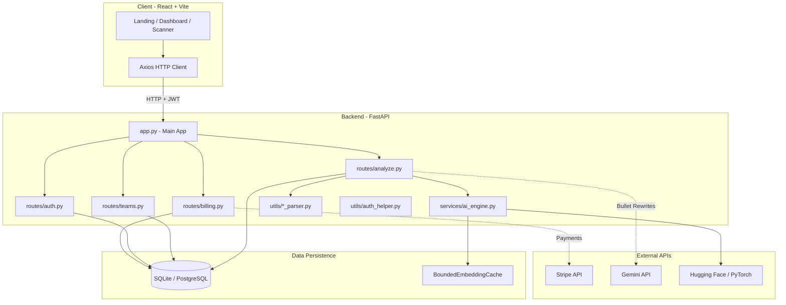
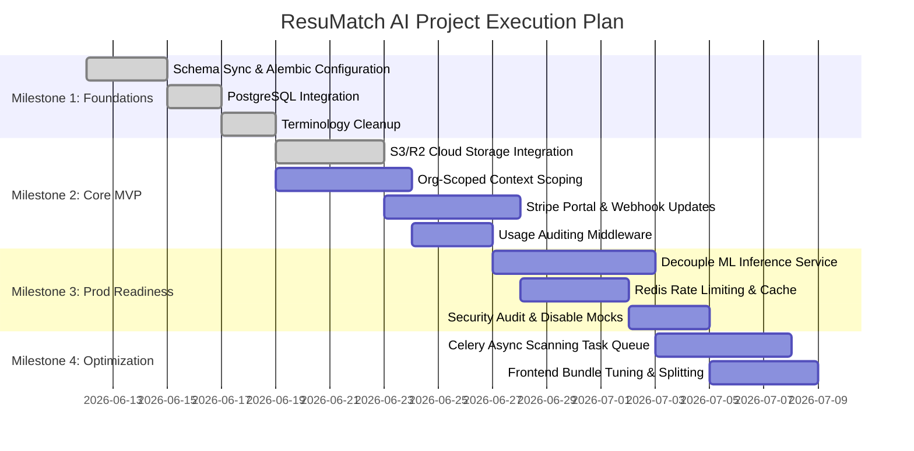

# ResuMatch AI — Project Analysis & Development Roadmap

## 1. Executive Summary

ResuMatch AI is a multi-tenant SaaS Applicant Tracking System (ATS) compatibility scanner designed to evaluate candidates' resumes against target job descriptions. By employing a **hybrid evaluation engine** that blends lexical n-gram overlap (40%) with semantic transformer embeddings (60%), the system provides accurate matching scores and highlights critical skill gaps.

### Project Health & Completion Outlook
- **Core Technology Viability**: Highly functional and verified. The parser engines (PDF/DOCX) and matching engines are well-engineered, resilient to failure (with fallback mechanisms), and supported by strong unit test coverage.
- **SaaS Framework Completeness**: Moderate. While user auth, mock billing, team invites, and API key management exist in the code, multiple core SaaS modules outlined in the system design and database schemas (such as true workspace scoping, usage log audits, active subscriptions via Stripe, and persistent file storage) are either missing or bypassed.
- **Production Readiness**: **Not yet ready**. Although the codebase compiles and tests pass, it relies on SQLite by default, lacks database migrations, lacks actual Cloud storage (storing static placeholders), and runs heavy transformer models inside the web process, which presents severe scalability and resource bottlenecks.
- **Estimated Completion**: Bringing this project to a fully functional, production-ready SaaS product will require approximately **4 to 6 weeks** of dedicated engineering effort.

---

## 2. System Architecture Review



### Current Architecture Assessment
1. **Application Layer (FastAPI)**: Lightweight and performant. FastAPI's async capabilities are excellent for I/O bound tasks, but the semantic matching model (`all-MiniLM-L6-v2`) is CPU/GPU-bound. Loading and running PyTorch inference inside the ASGI event loop blocks execution thread pools, limiting concurrency.
2. **Persistence Layer (SQLAlchemy ORM)**: Works well for structured queries, but it is currently desynced from the `prisma/schema.prisma` file (which serves as the conceptual source of truth). The absence of a migration framework (e.g., Alembic) presents high operational risk.
3. **Multi-Tenancy Model**: Structurally sound at the database schema level (using `Organization` and `Membership` roles). However, the application layer doesn't enforce org-level data scoping. Resume uploads and queries are associated directly with the `User.id` rather than the active workspace Organization context.
4. **Caching Strategy**: The backend implements an in-process, thread-safe LRU cache (`BoundedEmbeddingCache` in `server/services/ai_engine.py`). While efficient for single-instance setups, it will fail to share cache hits in horizontal auto-scaling scenarios.

### Architectural Recommendations
- **Decouple Heavy ML Inference**: Offload sentence embeddings to a serverless function, a dedicated model server (e.g., FastAPI running on a GPU-enabled node, or Hugging Face Inference Endpoints), or utilize external vector databases/caching.
- **Centralize Multi-Tenant Context**: Implement a FastAPI dependency that extracts and validates the active `Organization` header, ensuring all database select/insert queries scope query filters to the active organization tenant ID.
- **Implement Distributed Caching**: Replace the in-process embedding cache with a Redis cluster to enable shared lookups across multiple backend nodes.
- **Introduce File Storage Abstraction**: Integrate Cloudflare R2 or AWS S3 client wrappers to replace the placeholder `database-direct` strings, uploading original PDF/DOCX files securely.

---

## 3. Current State Assessment

### 3.1 Completed Components
- **Hybrid Scoring Core** (`server/services/ai_engine.py`): Vector similarity scoring, unigram/bigram tokenization, keyword matching, and custom stop-word lists. Includes robust double-checked thread-safe SpaCy model loading.
- **Document Extractors** (`server/utils/pdf_parser.py`, `docx_parser.py`): Successfully reads text from PDF and Word files (including tables).
- **Contact & Section Parser** (`server/utils/resume_parser.py`): Extracting names, emails, phones, and LinkedIn links via regex, and dividing resumes into structured blocks (skills, experience, education, projects).
- **Core User Authentication** (`server/routes/auth.py`, `utils/auth_helper.py`): Hashing passwords (bcrypt), generating JWT tokens, and verifying user context on protected routes.
- **Scan History and Deletion** (`server/routes/analyze.py`): Standard CRUD operations for keeping logs of past comparisons.
- **API Key Lifecycle** (`server/routes/teams.py`): Prefix generation, secure storage (SHA-256 hash), limit enforcement, and revocation endpoints.
- **Roster Controls** (`server/routes/teams.py`): Inviting users, adding roles (`OWNER`, `ADMIN`, `RECRUITER`, `VIEWER`), and removing members.
- **PDF Exporter** (`server/routes/analyze.py`): ReportLab implementation that generates a beautifully styled PDF on-the-fly and streams it to the client.
- **Frontend UI Shell** (`client/src/App.jsx`, `client/src/components/`): Dark mode, sidebar panel tabs, dropzone component, and statistics panels are complete.

### 3.2 Partially Implemented Components
- **Stripe Subscriptions** (~60% complete): Checkout session redirect `/checkout-session` and webhook `/webhook` are in place, but customer billing portals, upgrade/downgrade flows, handling of past_due/canceled statuses, and Stripe product updates are missing.
- **AI Bullet Point Suggestions** (~75% complete): Gemini API integration is functional but lacks prompt tuning, robust validation of model JSON outputs, or a dashboard interface to edit/apply suggestions.
- **Rate Limiting** (~50% complete): `slowapi` is initialized in `utils/limiter.py`, but it is not consistently registered across all routers or backed by an out-of-process store (Redis), meaning it resets on server restart and is worker-isolated.

### 3.3 Missing Components
- **Workspace Scoping endpoints**: The DB has `Workspace` models, but no API endpoints or UI exist to manage them. Workspaces are bypassed, with everything scoped to the root `Organization`.
- **Usage & Audit Logging**: Tables exist, but nothing writes to them when scans are run, members are invited, or keys are generated.
- **Report Database Persistence**: The `Report` model is missing in SQLAlchemy. PDF exports are built dynamically but never saved to permanent storage, preventing the sharing of reports via unique links.
- **Notification Framework**: Email alerts, invitation accepts, and in-app system notifications are completely absent.
- **Referrals & Affiliate Program**: Conceptual Prisma schemas exist, but no application code, endpoints, or dashboards are implemented.
- **Database Migrations**: No migration tool (Alembic) is configured. DB creation relies entirely on `Base.metadata.create_all()`.

### 3.4 Technical Debt
- **Term Conflation**: The UI uses the term "Workspace" when it is actually creating and modifying `Organization` entities. The actual `Workspace` database model is unused.
- **Schema Desync**: `prisma/schema.prisma` contains multiple models (e.g., `Report`, `Payment`, `Notification`, `Referral`, `Affiliate`) and fields (e.g., `emailVerified`, `resetToken`) that are missing in the SQLAlchemy `server/models.py` implementation.
- **Local SQLite Configuration**: Hardcoded as the default database connection, which is unsuitable for concurrent production writes.
- **Hardcoded Formatting**: Prompt templates, ReportLab page offsets, and styling variables are hardcoded inside backend endpoints instead of configuration files.

---

## 4. Gap Analysis

| Feature | Intended Functionality | Current Status | Missing Pieces | Complexity | Dependencies |
| :--- | :--- | :--- | :--- | :--- | :--- |
| **Workspace Management** | Multi-tenant organization workspace separation for teams to group scanned resumes. | Missing in code. Terminal "Workspaces" in the UI map directly to `Organization` models. | Workspace CRUD endpoints, UI workspace panels, and database schema scoping. | **Medium** | Organization model |
| **Stripe Billing Portal** | SaaS subscription management, allowing users to upgrade, downgrade, update cards, or cancel. | Basic Checkout redirect and invoice webhook are implemented. | Customer Billing Portal redirection endpoint, webhook handlers for `customer.subscription.deleted`/`updated`. | **Medium** | Stripe SDK, DB Subscription model |
| **Persistent File Storage** | Storing uploaded PDF/DOCX resumes securely in the cloud to allow team retrieval. | Placed in DB as raw text; `file_url` is stored as `"database-direct"`. | AWS S3/Cloudflare R2 storage provider client and upload/download signing utility. | **Medium** | Boto3/Aiobotocore dependencies |
| **Usage Auditing & Limits** | Logging and auditing of API and GUI actions (e.g., scan counts, seat invites) for compliance and billing quotas. | Models exist in database schema, but are completely unused. | Decorators/middleware to write to `UsageLog` and `AuditLog` models on protected endpoints. | **Low** | Database session |
| **Shareable PDF Reports** | Generation of report bundles and unique share links for recruiters. | Streams raw PDFs dynamically; does not persist report records. | SQLAlchemy `Report` model, cloud PDF uploads, and `/reports/{id}` share endpoints. | **Medium** | S3 client, ReportLab |
| **Database Migrations** | Safe evolution of database schemas in development and production environments. | Database tables are created dynamically using `create_all()`. | Alembic migration scripts initialized and configured. | **Low** | SQLAlchemy |

---

## 5. Development Roadmap

```
                                  [MILESTONE 1: Critical Foundations]
                                                 │
                                                 ▼
                                   [MILESTONE 2: Core Functionality]
                                                 │
                                                 ▼
                                  [MILESTONE 3: Production Readiness]
                                                 │
                                                 ▼
                                       [MILESTONE 4: Optimization]
                                                 │
                                                 ▼
                                    [MILESTONE 5: Future Enhancements]
```

### Milestone 1: Critical Foundations (P0) [COMPLETED]
*Focus: Align schemas, database configuration, and developer environment stability.*
- [x] **Task 1.1: Database Schema Alignment & Alembic Configuration**
  - *Description*: Sync `server/models.py` with `prisma/schema.prisma` (adding `Report`, `Payment`, `Notification`, `Referral`, `Affiliate` models). Initialize Alembic for migrations.
  - *Status*: Completed (Alembic initialized, schemas aligned)
- [x] **Task 1.2: Database Migration to PostgreSQL**
  - *Description*: Setup local and staging PostgreSQL databases. Update database pooling and dialect-specific logic in `utils/db.py`.
  - *Status*: Completed (Local Postgres database configured, pooling and dialect logic added, migrations successfully applied)
- [x] **Task 1.3: Decouple Terms & Clean Terminology**
  - *Description*: Standardize terminology. Define if `Workspace` is a sub-folder of `Organization`, or remove the `Workspace` entity entirely from database models to prevent code pollution.
  - *Status*: Completed (Removed Workspace entity entirely from database models/schemas to prevent code pollution)

### Milestone 2: Core Functionality (P1)
*Focus: Complete missing SaaS pipelines required for an MVP.*
- [x] **Task 2.1: S3 / Cloudflare R2 Integration**
  - *Description*: Build file upload utility to store original uploaded files securely in cloud buckets instead of database-direct text strings.
  - *Status*: Completed (S3/R2 upload utility, secure download, and serving endpoints implemented)
- **Task 2.2: Scoped Database Queries (Multi-Tenancy)**
  - *Description*: Rewrite query scoping. Ensure resume listings and analysis results are filtered by active `organization_id` instead of raw user IDs.
  - *Effort*: 5 days | *Owner*: Lead Backend Engineer
- **Task 2.3: Stripe Billing Lifecycle Completions**
  - *Description*: Implement customer billing portal redirect. Support subscription updates, cancellations, and past-due webhooks.
  - *Effort*: 5 days | *Owner*: Backend Engineer
- **Task 2.4: API Usage Auditing & Quota Middleware**
  - *Description*: Implement middleware to log operations in `UsageLog` and block actions if organization scan limits are exceeded.
  - *Effort*: 3 days | *Owner*: Backend Engineer

### Milestone 3: Production Readiness (P1)
*Focus: Secure, scale, and stabilize the system.*
- **Task 3.1: Externalize Heavy Transformer Inference**
  - *Description*: Decouple Sentence-Transformers from the main FastAPI server. Create a dedicated container/service or integrate an external API endpoint.
  - *Effort*: 6 days | *Owner*: Machine Learning Engineer / DevOps
- **Task 3.2: Redis-Backed Rate Limiting & Embedding Cache**
  - *Description*: Configure slowapi to run on Redis. Transition `BoundedEmbeddingCache` to store vector embeddings in Redis.
  - *Effort*: 4 days | *Owner*: DevOps Engineer
- **Task 3.3: Production Environment Variables & Security Audit**
  - *Description*: Secure session configurations. Ensure mock endpoints (like `/mock-upgrade`) are strictly disabled in production builds. Validate API key hashing.
  - *Effort*: 3 days | *Owner*: Security Analyst / Lead Backend Engineer

### Milestone 4: Optimization (P2)
*Focus: Enhance system performance and UX.*
- **Task 4.1: Asynchronous Processing & Queue Integration**
  - *Description*: Implement Celery or RQ for processing document uploads and running semantic analysis asynchronously.
  - *Effort*: 5 days | *Owner*: Backend Engineer
- **Task 4.2: Frontend Performance & Code Splitting**
  - *Description*: Optimize react bundles, split components, and cache history logs on the client side.
  - *Effort*: 4 days | *Owner*: Frontend Engineer

### Milestone 5: Future Enhancements (P3)
*Focus: Nice-to-have features for subsequent growth.*
- **Task 5.1: Referral & Affiliate Portal**
  - *Description*: Build Referral landing pages and Affiliate link generation dashboards for user acquisition.
  - *Effort*: 7 days | *Owner*: Fullstack Engineer
- **Task 5.2: Shared Report Links & Portals**
  - *Description*: Enable generation of public links for recruiters to share ATS reports with external hiring managers.
  - *Effort*: 4 days | *Owner*: Fullstack Engineer

---

## 6. Implementation Plan & Execution Sequence



### 6.1 Parallel Execution Pathways
- **Frontend & Terminology Alignment** (Task 1.3) can run in parallel with the **PostgreSQL Migration** (Task 1.2).
- **S3 Storage Implementation** (Task 2.1) and **Org-level Scoping** (Task 2.2) can be developed concurrently by separate engineers since the storage layer does not depend on database tenant contexts.
- **Decoupling ML Inference** (Task 3.1) can be run concurrently with **Stripe Billing Updates** (Task 2.3).

---

## 7. Deliverables & Outputs

### 7.1 Feature Completion Matrix

| Feature Module | Files Involved | Implementation Status | % Complete | Priority | Notes |
| :--- | :--- | :--- | :--- | :--- | :--- |
| **Lexical Engine** | `ai_engine.py` | Production Ready | 100% | P0 | Verified with pytest unit tests |
| **Semantic Engine** | `ai_engine.py` | Partially Complete | 80% | P0 | Runs in-process; blocks event loop |
| **PDF/DOCX Extraction** | `pdf_parser.py`, `docx_parser.py` | Production Ready | 100% | P0 | Signature validation complete |
| **Resume Segmentation** | `resume_parser.py` | Production Ready | 95% | P0 | Verified; simple heuristics |
| **User Authentication** | `auth.py`, `auth_helper.py` | Production Ready | 100% | P0 | Secure bcrypt password hashing |
| **Team Management** | `teams.py` | Production Ready | 95% | P1 | Active members fully controlled |
| **API Keys Management** | `teams.py` | Production Ready | 90% | P1 | Free tier restriction complete |
| **Billing & Webhooks** | `billing.py` | Partially Complete | 60% | P1 | Missing self-serve cancellation |
| **Report Export** | `analyze.py` | Partially Complete | 70% | P1 | Dynamic streaming; no DB persistence |
| **Workspaces Scoping** | `models.py` | Missing | 0% | P2 | Conceptual schema only |
| **Usage / Audit Logs** | `models.py` | Missing | 0% | P2 | Models exist; no writes occur |
| **Referrals & Affiliates** | `schema.prisma` | Missing | 0% | P3 | No application code present |

### 7.2 Risk Register

| Risk Event | Severity | Impact | Mitigation Strategy |
| :--- | :--- | :--- | :--- |
| **Out-of-Memory (OOM) Crashes** | **High** | Critical | Run Hugging Face sentence-transformers on a dedicated backend server or serverless GPU function, separate from main API web server. |
| **FastAPI Thread Blocking** | **Medium** | High | Wrap CPU-bound sentence tokenization and matrix math in `anyio.to_thread.run_sync` or execute in celery background workers. |
| **Database Lockouts (SQLite)** | **High** | High | Migrate immediately to PostgreSQL for multi-tenant, concurrent write database transactions. |
| **Bypass of Stripe Payments** | **High** | Critical | Use environment-based configuration to conditionally register testing endpoints (`/mock-upgrade`) only when `FLASK_DEBUG=True`. |
| **Plaintext JWT Hashing Leak** | **Low** | Medium | Enforce environment validation that crashes the application startup if `SECRET_KEY` matches the default developer fallback. |

### 7.3 Estimated Time to Completion (ETC)

- **Optimistic Estimate**: **3 Weeks** (Assuming no ML decoupling issues, direct PostgreSQL deployment, and quick Stripe verification).
- **Realistic Estimate**: **5 Weeks** (Accounting for Alembic schema migrations, celery background task queue setups, and S3 file integrations).
- **Conservative Estimate**: **7 Weeks** (Accounting for team training, complex integration testing, and deployment pipeline delays).

---

## 8. Recommended Next Actions (Top 10 Immediate Tasks)

1. **Configure Alembic** in the `server` directory and generate the initial migration script.
2. **Setup PostgreSQL** locally and modify `DATABASE_URL` configurations.
3. **Align database models** by copying the missing models (`Report`, `Payment`, `Notification`, `Referral`, `Affiliate`) from `prisma/schema.prisma` into `server/models.py`.
4. **Remove `/mock-upgrade` endpoint availability** for production environments via runtime environment flag checks.
5. **Decouple the UI "Workspace" terminology** so that client requests call the API using `/api/orgs` rather than workspace names.
6. **Implement AWS S3 or Cloudflare R2** client helper and modify the file ingestion code to save files.
7. **Introduce Celery task management** with a Redis broker to handle PDF/DOCX parsing asynchronously.
8. **Scope analysis endpoints** to filter query results using the logged-in user's active organization ID.
9. **Configure slowapi rate-limits** to use Redis for sharing rates across multiple FastAPI server threads/processes.
10. **Write integration tests** for organizational team invitations and billing webhook scenarios.
